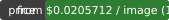

# Qwen-Image 3.0 Prompts — 8 Tested Recipes With Outputs

<!-- conv-kit:v1 -->

<p align="center">
    
</p>

<p align="center">
  
</p>

> **from $0.0205712 per image** (1K $0.0205712 · 2K $0.0205712) — one OpenAI-compatible endpoint at `https://api.apimart.ai/v1`, no monthly plan required. *(observed 2026-10-12)*

**[Get an API key](https://go.apimart.ai/k-134bb5)** · **[Live pricing](https://go.apimart.ai/k-2379ce)** · **[Model page](https://go.apimart.ai/k-c44590)** · [⚡ 60-second quickstart](#quickstart)

**Why teams call Qwen-Image 3.0 (`qwen-image-3.0`) through APIMart**

- **One key, entire catalog.** The same `https://api.apimart.ai/v1` base URL and `Authorization` header reach Qwen-Image 3.0 (`qwen-image-3.0`) and 300+ other image, video and language models — switch the `model` field, not your client.
- **$1 minimum, pay as you go.** No subscription and no prepaid plan to size up front: top up from $1 and spend it on calls.
- **The charge comes back in the response.** Every completed task reports the amount billed (`cost` / `credits_cost`); a task marked `failed` is refunded.
- **Async by design.** Submit, take the `task_id`, poll `GET /v1/tasks/{id}` — batching and retries are ordinary queue work, not a bespoke integration.

<!-- /conv-kit:v1 -->

Qwen-Image 3.0 does text-to-image generation and editing with 1K/2K output through Alibaba's Qwen image route.

## Model id and routes

| Route | `model` value | Billing | Notes |
| --- | --- | --- | --- |
| Per-image | `qwen-image-3.0` | per delivered image, by resolution | see the [model page](https://go.apimart.ai/k-d5cf2c) for the exact tiers |

Endpoint: `POST https://api.apimart.ai/v1/images/generations` (OpenAI-compatible), then poll `GET /v1/tasks/{task_id}`.

## Pricing

<!-- pricing:model:start -->
| Output | List price | Effective price |
| --- | --- | --- |
| default | 0.025714 | 0.0205712 |
| 1K | 0.025714 | 0.0205712 |
| 2K | 0.025714 | 0.0205712 |


<!-- pricing:model:end -->

Prices are a snapshot; the [pricing page](https://go.apimart.ai/k-2379ce) and [`data/model.json`](data/model.json) are refreshed by CI, and a completed task reports the exact amount in its `cost` field.

## Request parameters

| Field | Type | Default | Notes |
| --- | --- | --- | --- |
| `model` | string | required | the model id shown in the route table above |
| `prompt` | string | required | what to generate, or what to change when editing |
| `size` | string | `auto` / `1:1` | aspect ratio, or `auto` where the route supports it |
| `resolution` | string | `1K` | output resolution tier — cost scales with it |
| `n` | integer | `1` | number of images per task, where the route allows more than one |
| `image_urls` | string[] | — | reference images as public HTTP(S) URLs or base64 data URLs |
| `nsfw_check` | boolean | `false` | runs `omni-moderation-latest` before submitting |

The table lists the fields accepted by the APIMart OpenAI-compatible image endpoint. Check the [model page](https://go.apimart.ai/k-d5cf2c) for anything this model adds on top.

## Quickstart

```bash
curl --request POST --url https://api.apimart.ai/v1/images/generations \
  --header "Authorization: Bearer $APIMART_API_KEY" --header 'Content-Type: application/json' \
  -d '{"model":"qwen-image-3.0","prompt":"A bamboo forest at sunrise, slow push-in","size":"1:1","resolution":"1K"}'
```

```python
import os, time, requests

BASE = "https://api.apimart.ai/v1"
HEADERS = {"Authorization": f"Bearer {os.environ['APIMART_API_KEY']}", "Content-Type": "application/json"}

created = requests.post(f"{BASE}/images/generations", headers=HEADERS, timeout=60, json={
    "model": "qwen-image-3.0", "prompt": "A bamboo forest at sunrise, slow push-in",
}).json()
task_id = created["data"]["id"]

while True:
    task = requests.get(f"{BASE}/tasks/{task_id}", headers=HEADERS, timeout=60).json()["data"]
    if task["status"] in ("completed", "failed"):
        break
    time.sleep(5)
print(task.get("cost"), task["result"]["images"][0]["url"])
```

Runnable versions: [`examples/`](examples). The task lifecycle is `pending → processing → completed | failed`.

## FAQ

**What is the Qwen-Image 3.0 model id?**

`qwen-image-3.0`. See the route table above.

**How is it billed?**

**from $0.0205712 per image** (1K $0.0205712 · 2K $0.0205712). The completed task reports the exact amount in its `cost` field; a failed task is refunded.

**How do I get a key?**

Use the [Get an API key](https://go.apimart.ai/k-134bb5) link — $1 minimum top-up, no plan required.

## Attributed links (how this repository is measured)

| Purpose | Attributed link | Target |
| --- | --- | --- |
| Model page | <https://go.apimart.ai/k-c44590> | `apimart.ai/model/qwen-image-3-0` |
| Live pricing | <https://go.apimart.ai/k-2379ce> | `apimart.ai/pricing` |
| Get an API key | <https://go.apimart.ai/k-134bb5> | `apimart.ai/keys` |

Outbound APIMart links are minted through the promo link API; hand-made tracking parameters are rejected by
`tools/check_links.py` in CI.

## Disclosure

Qwen-Image 3.0 is a third-party model served through APIMart; this repository documents how to call it and publishes
model ids and prices, and does not claim official status. Model names, prices and documentation belong to their
respective owners.

## License

MIT — see [LICENSE](LICENSE).
